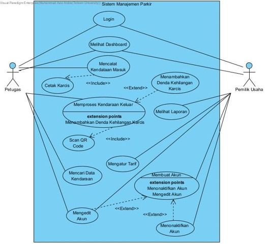
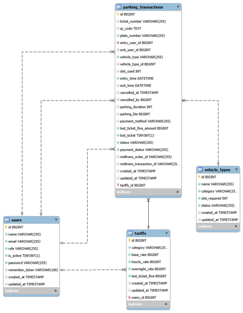
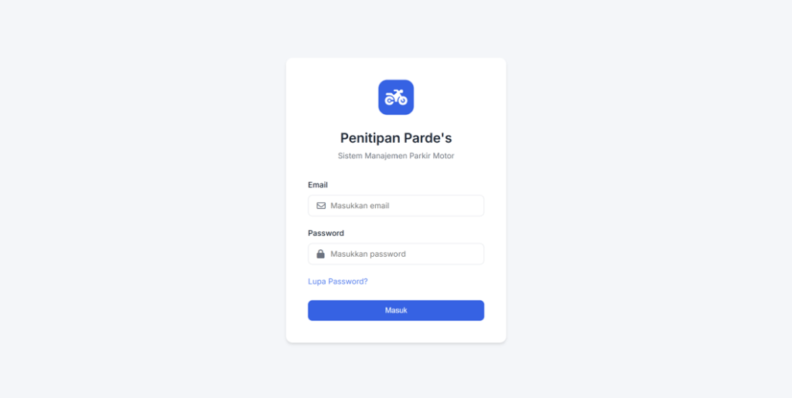
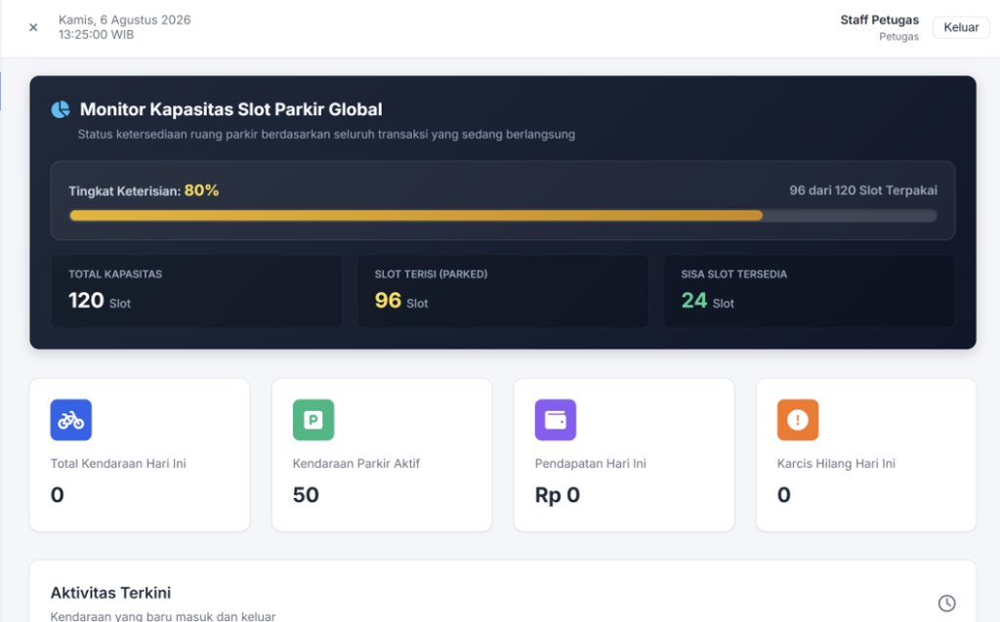
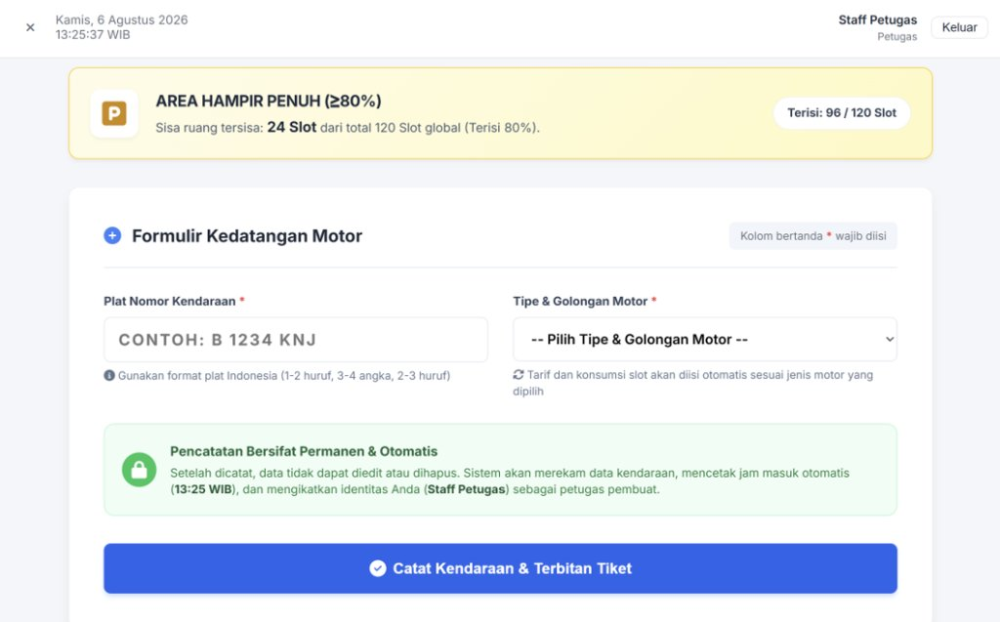
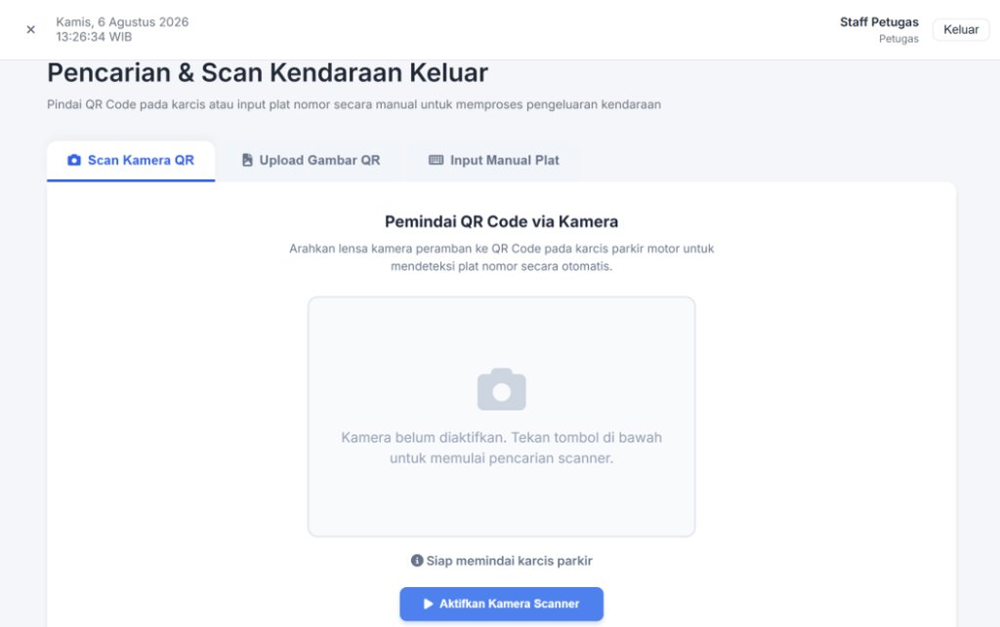
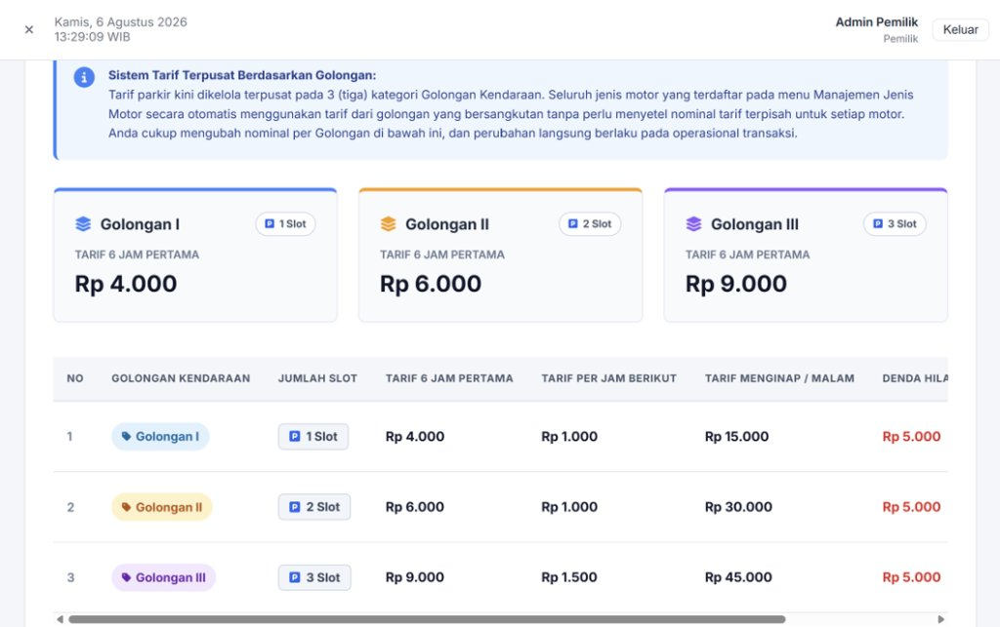

<h1 align="center">Penitipan Parde's — Motorcycle Parking Management System</h1>

<p align="center">
  
  
  
  
  
  
</p>

## About Penitipan Parde's

**Penitipan Parde's** is a web-based motorcycle parking management system developed as an undergraduate thesis (*Skripsi / Tugas Akhir*) project[cite: 1]. Built with **Laravel 13** and **Tailwind CSS 4** using the **Prototyping Software Development Life Cycle (SDLC)**, this application digitizes and automates daily motorcycle parking operations—replacing manual paper logs with real-time slot capacity monitoring[cite: 2], QR code ticketing[cite: 3, 4], digital payment gateway integration (Midtrans), and tamper-proof transaction records[cite: 4].

## Key Features

### Authentication & Role-Based Access Control (RBAC)
- **Secure Login & Password Recovery:** Full authentication flow including verification code-based password reset (`/forgot-password` & `/reset-password`).
- **Role Separation:** Distinct operational privileges for **Admin (Owner)** and **Staff (Parking Attendant)**.

### Staff Operations (`role:staff`)
- **Automated Vehicle Entry & PDF Ticketing:** Streamlined arrival logging with Indonesian license plate format validation[cite: 4], automatic tariff & slot consumption calculation[cite: 4], and instant PDF ticket generation embedded with a unique QR Code.
- **Immutable Audit Trail:** Once recorded, entry timestamps and attendant identities are permanently locked to prevent data tampering[cite: 4].
- **Multi-Method Exit & QR Code Scanner:**
  - **Live Camera Scanner:** Browser-based camera scanning for instant ticket lookup at exit gates[cite: 3].
  - **QR Image Upload:** Direct ticket QR image upload support[cite: 3].
  - **Manual License Plate Search:** Fallback search for damaged or lost tickets[cite: 3].
- **Digital & Cash Checkout:** Integrated with **Midtrans Snap** for cashless payments (with real-time webhook notification & manual status synchronization) alongside PDF receipt printing.

### Admin Management (`role:admin`)
- **Real-Time Capacity & Revenue Dashboard:** Live global slot occupancy monitor with visual threshold warnings ($\ge 80\%$ capacity alert)[cite: 2, 4], daily vehicle counts[cite: 2], active parked motorcycles[cite: 2], daily revenue[cite: 2], and lost ticket tracking[cite: 2].
- **Tariff & Motorcycle Category Management:** Configure parking rates and manage motorcycle types with soft-disable toggles (preserving historical transaction integrity).
- **Global Slot Capacity Settings:** Dynamically adjust total available parking slots.
- **Financial & Operational Reports:** Comprehensive transaction reporting with one-click export to **PDF** and **Excel**.
- **User & Business Profile Management:** Manage attendant accounts (activate/deactivate staff access) and customize business details and branding logos.

## Development Methodology: Prototyping

This project was engineered using the **Prototyping Model**, ensuring continuous alignment between system behavior and real-world parking attendant workflows:

1. **Requirements Gathering:** Identifying operational bottlenecks in manual motorcycle parking facilities (slot overbooking, slow exit queues, and ticket fraud).
2. **Quick Design & Prototyping:** Building a high-contrast, fast-response interface optimized for gate attendants.
3. **User Evaluation & Refinement:** Iterative validation of QR scanning speed, capacity alert thresholds ($\ge 80\%$)[cite: 4], Midtrans webhook handling, and immutable entry logging[cite: 4].
4. **System Implementation:** Full-stack deployment utilizing Laravel MVC architecture.

## Tech Stack

| Layer | Technology |
| :--- | :--- |
| **Backend Framework** | PHP `^8.3`, Laravel `^13.8` |
| **Frontend & Styling** | Blade Templates, Tailwind CSS `^4.0`, Vite `^8.0` |
| **Database** | SQLite (Default) / MySQL |
| **Payment Gateway** | Midtrans PHP SDK (`midtrans/midtrans-php ^2.6`) |
| **PDF & QR Generation** | `barryvdh/laravel-dompdf ^3.1`, `simplesoftwareio/simple-qrcode ^4.2` |

## System Design & UML Diagrams

### Use Case Diagram
[cite: 5]

### Entity Relationship Diagram (ERD)
[cite: 5]

## Application Screenshots

| Login Page | Real-Time Capacity Dashboard |
| :---: | :---: |
| [cite: 5] | [cite: 5] |
| **Motorcycle Entry Form** | **QR Code Exit Scanner** |
| [cite: 5] | [cite: 5] |

### Tariff Management
[cite: 5]

## Installation & Local Setup

### Prerequisites
- PHP `>= 8.3`
- Composer
- Node.js & NPM

### Quick Setup

1. **Clone the repository**
   ```bash
   git clone [https://github.com/azizaldira/Pardes-Motorcycle-Parking.git](https://github.com/azizaldira/Pardes-Motorcycle-Parking.git)
   cd Pardes-Motorcycle-Parking
   ```

2. **Run automated setup & seed default users**
    ```bash
    composer setup
    php artisan db:seed
    ```
3. **Configure Midtrans in .env**
    Open the generated .env file and fill in your Midtrans Sandbox/Production credentials:
    ```bash
    MIDTRANS_SERVER_KEY=your_midtrans_server_key
    MIDTRANS_CLIENT_KEY=your_midtrans_client_key
    MIDTRANS_IS_PRODUCTION=false
    MIDTRANS_IS_SANITIZED=true
    MIDTRANS_IS_3DS=true
    ```
    (If using MySQL instead of the default SQLite database, update DB_CONNECTION=mysql and your database credentials in .env, then re-run php artisan migrate --seed.)
4. **Start the development environment**
    Run the concurrent development server (Laravel server, queue listener, Pail logs, and Vite):
    ```bash
    composer dev
    ```
    Or run the standard server manually:
    ```bash
    php artisan serve
    ```
## Default Demo Credentials

After running `php artisan db:seed`, you can log in using the following pre-configured accounts:

| Role | Name | Email | Password |
| :--- | :--- | :--- | :--- |
| **Admin** | Admin Pemilik | ` admin@gmail.com` | `admin123` |
| **Staff** | Staff Petugas | `staff@gmail.com` | `staff123` |

## License

This project was created for academic purposes as part of an undergraduate thesis (Tugas Akhir) under the [MIT license](https://opensource.org/licenses/MIT).
